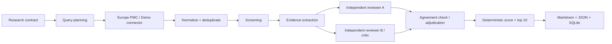

# Literature Radar (Research Agent)

Python + Pydantic + LangGraph prototype, with SQLite checkpointing and a Markdown/JSON report.
The first milestone demonstrates the whole loop on one topic, with at most 30 candidates
and at most 10 results. It analyzes **abstracts**, not full text.

## Quick start — no API keys

Requires Python 3.11+. From this directory:

```sh
python3.12 -m venv .venv
source .venv/bin/activate
pip install -e '.[dev,live]'
research-agent "retrieval augmented generation" --mode demo --run-dir runs/demo
pytest -q
```

Open `runs/demo/report.md`. **The demo is entirely synthetic**, including the papers,
scores and reviews. It checks the system's mechanics, not the scientific performance of the models.
The demo generates 12 candidates and deliberately exercises the adjudication route.

## Live search and evaluation

```sh
cp .env.example .env
# Fill in model IDs and provider keys in .env.
research-agent "retrieval augmented generation clinical question answering" \
  --mode live --max-papers 5 --run-dir runs/live-01
```

`RESEARCH_MODEL` configures the planner, screening and extraction. Reviewer A, reviewer B
and the adjudicator each have an override in `.env.example`. Format: `provider:model-id`.
LangChain integrations for OpenAI and Anthropic are included; other integrations can be added.
There is no default live model, no bundled key and no silent fallback to demo.
The configuration is read at start and saved without keys in the manifest.
The topic and abstracts are sent to the configured providers. Models are called without tools.

Recommended for the first live run: 5 candidates. Maximum logical calls for N candidates:
`1 + 5N` (planner, screening, extraction, two reviews and possibly adjudication).
Provider retries can produce extra requests. At most 2 concurrent reviews;
the rest of the work per stage is sequential. Model timeout 60s, at most 2 SDK retries,
output limited to 2500 tokens/call. No strict monetary budget is implemented.

## Fields (domain.json)

A field = topic + inclusion criteria (all must be true) and exclusion criteria (any one removes
the paper) + sources (Europe PMC, OpenAlex, arXiv) + year range + Jev thresholds. The web app writes
`domain.json`; from the command line:

```bash
research-agent --domain field.json --mode demo --run-dir runs/field-demo
research-eval screen gold/toy.json --run-dir runs/eval-field --field field.json
```

`domain.json` is copied into the run directory and appears in `manifest.json`. In `report.json`, each
screen has `criteria` (per criterion: `jev_p`, the LLM answer `yes|no|unclear`, the verified quote) and
`decided_by` (the criterion that removed the paper, or `null`); each paper has `sources`.
Runs with a positional topic are unchanged (a single `topic_match` question).

## Review panel (review.json)

With `--review review.json` (combinable with `--domain` or with a topic), papers kept at screening are
read in full text where legally available (PMC OA, Unpaywall, uploaded PDF) and evaluated by a panel
(by default Methodologist, Clinician, Statistician; checklist from CLAIM/TRIPOD+AI) plus an editor. The score,
coverage and red flags are computed in code. Uploaded PDFs go in `<run>/uploads/<id>.pdf`
(`MED:123` → `MED_123.pdf`) or in a directory given with `--uploads DIR`.

```bash
python -c "import json; from research_agent.panel import default_review; print(json.dumps(default_review()))" > review.json
research-agent "topic" --review review.json --mode demo --run-dir runs/panel-demo
```

`report.json` → `state.review[<paper id>]`: `text_source`, `reviews`, `editor`, `score`, `coverage`, `red_flags`.

## Resuming after an interruption

```sh
research-agent "retrieval augmented generation" --run-dir runs/checkpoint --stop-after extract
research-agent --run-dir runs/checkpoint --resume
```

The same `--resume` command also resumes a run stopped by an exception. The manifest keeps the topic,
mode and models. Checkpoints are at node boundaries; the SQLite cache of validated calls
avoids repeating calls already saved from a partially executed node.
A crash between the provider's response and the save can repeat a call: we do not promise exactly-once.
An existing directory cannot be overwritten with a new run. A completed run can regenerate the report.
Use a single CLI instance per run directory. Do not load unknown checkpoint databases.

## Architecture



| Module | Responsibility |
|---|---|
| `schemas.py` | Pydantic contracts, decisions, evidence, provenance, limits |
| `connectors.py` | Connector protocol, Europe PMC, fixture, deduplication |
| `agents.py` | Versioned prompts, model configuration, structured output, auditable cache |
| `graph.py` | LangGraph nodes, parallel reviews, fan-in barrier, adjudication, scoring |
| `storage.py` | Hash-addressed raw payloads, model calls, papers |
| `report.py` | Report and export of the whole state |
| `cli.py` | Initialization, persistent checkpoint and resume |

Reviewers A and B receive the same topic, abstract and evidence, without the other's review.
A looks for the supported contribution; B attacks validity and extrapolations. They are independent at
the context level, not statistically: the same models/evidence can produce correlated errors.
For diversity, configure different models. The adjudicator sees both reviews and the source.

Disagreement = a different verdict or a difference of at least 2 points on any component.
On agreement we use the minimum of the scores per component and keep both reviewers' observations.
On disagreement, the adjudicator produces scores and a reason; `uncertain` does not enter the top.

Score v1 = `100 × (0.4 relevance + 0.3 methods + 0.3 support) / 4`, each 0–4.
`methods` measures the methodological details visible in the abstract, not verified quality.
The score is a deterministic formula applied to LLM judgments, so the live ranking is not
numerically reproducible with new calls. The cache and snapshots allow exact auditing of a run.
Ties are ordered by stable ID. We do not artificially fill up to 10.

## Provenance and persistence

Each candidate keeps its ID, normalized DOI, title, year, abstract, query, source, URL,
timestamp and the hash of the original payload. Deduplication merges by ID/DOI and, conservatively,
by normalized title + year; it does not merge by title two known, different DOIs.
Each extracted claim includes a quote verified as an exact substring of the abstract.
This check proves the quote exists, not that it logically implies the claim.

In the run directory:

- `manifest.json`: contract, models, prompt/scoring versions and main packages.
- `checkpoints.sqlite`: LangGraph state, finished branches and the next step.
- `research.sqlite`: tables `raw`, `calls`, `papers`; validated input/output for each call.
- `report.json`: the whole trail, including screening, evidence, the separate reviews and the decisions.
- `report.md`: top, strengths, assessment, takeaways, limitations and provenance.

Network/schema/quote errors stop the run and keep the checkpoint; they do not become empty results.
The connector retries transient 429/5xx and transport errors (3 attempts), with a 30s timeout.
Missing abstracts are kept as `uncertain`, without ranking. An `uncertain` screening with an abstract
continues to evaluation. An empty search explicitly produces zero results.

## Limits of this milestone and next steps

- Europe PMC is a source oriented toward biomedicine/life sciences, not universal coverage.
- One page of at most N results per query, at most 3 queries; at most N unique candidates
  evaluated in discovery order. The top is within this batch, not across the whole literature.
- There is no full-text acquisition, retraction checking, double screening, validated risk-of-bias,
  normalization of preprint/journal families or calibration against human raters.
- A single screening model in M1; the schema allows auditing, but does not solve false negatives.
- Query planning and the reviews are bounded model calls, not autonomous agents with tools.
- There is no business translation, competitive intelligence or pgvector implementation.

Milestone 2: a real, manually labeled sample, measurement of screening recall and of reviewer agreement,
full text for open sources and extraction with section/paragraph localization.
Milestone 3: more connectors, pagination/dates, dynamic per-paper workers and cost limits.
Later, Store can be replaced with PostgreSQL and embeddings added; the `Paper`/`Evidence`/
`Decision` export is the extension point for downstream consumers, without implementing them now.

## Evaluation (research-eval)

`research-eval` measures screening against a published systematic review (SR): the papers included
in the SR are the positives, the remaining candidates found by the same query are the negatives. All model
calls are saved in the run's SQLite cache, and `report` runs offline from the cache
(it never calls APIs) and can replay the cascade at any pair of Jev thresholds.

```sh
research-eval build-gold sr_specs/x.yaml -o gold/x.json
research-eval screen gold/x.json --run-dir runs/eval-x --mode live
research-eval agreement gold/x.json --run-dir runs/eval-x --limit 40
research-eval report runs/eval-x --holdout runs/eval-y
```

- `build-gold`: resolves the SR studies in Europe PMC and freezes the gold set (content hash);
  `--max-candidates` (default 200) limits the number of candidates.
- `screen`: Jev and LLM screening on each candidate with an abstract; resumable, without repeated calls.
  Requires `TYPESAFE_API_KEY` in `.env`, even with `--mode demo`. A run directory accepts a single
  gold set; for another gold set use another `--run-dir`.
- `agreement`: reviewer A/B on all positives plus `--limit` sampled negatives (fixed seed);
  uses the same models as `screen`.
- `report`: writes `metrics.md` and `metrics.json` in the run directory. `--holdout` takes
  the directory of a run, already screened, on a DIFFERENT SR (the same gold is refused). If the run has
  Jev answers from different model versions, `report` stops, and
  `--allow-mixed-jev-versions` forces it.

Recommendation rule: it recommends the threshold pair with the most screening calls saved
among those that lose no SR positive that `llm_only` keeps (on the main set and, if given,
on the holdout); a pair that loses a positive on the holdout is explicitly rejected in the report. `--target-recall`
is now only an optional extra constraint (recall >= the given value).

Run the commands from the repo root: `.env` is read from the current directory.
The main CLI `research-agent` has the cascaded Jev layer: `--jev` (live only),
`--jev-min-confidence` (auto-include, default 0.6) and `--jev-exclude-min-confidence`
(auto-exclude, default 0.9, must be at least as high as the first).

`sr.yaml` format:

```yaml
name: ctffr-sr
citation: Autor et al. 2026
topic: deep learning CT-FFR
query: ("fractional flow reserve" AND "deep learning")
included:
  - doi: 10.1000/p1
  - title: Title of a study without a DOI
    year: 2024
```

What is measured: retrieval and screening recall (with a 95% Wilson interval), the list of missed
positives, a sweep of Jev thresholds (include/exclude) with a threshold recommendation, kappa between
reviewers A and B (alongside raw agreement and prevalence). Errors stop the command and are written to
`errors.log` in the run directory (type and message, without keys).

Limits:
- Precision is not the main metric: "included in the SR" reflects criteria applied to full text,
  not to the abstract, so the negatives are not certain negatives.
- The recommended thresholds are untested without `--holdout` (they are fitted on the same SR); with a single SR
  the "no losses relative to llm_only" rule can still overfit.
- If reviewers A and B are from the same model family, kappa is inflated (error correlation).

### Panel evaluation: `panel`, `ablation`, `human`

```sh
research-eval panel --gold gold/x.json --review review.json --eval-dir evals/panel-x --sample 20 --seed 0 --mode live
research-eval ablation evals/panel-x --eval-dir evals/abl-x            # offline; --rerun-editor costs calls
research-eval human evals/panel-x --ratings human_ratings.json         # copied into the eval folder
research-eval report evals/panel-x                                     # metrics.json: panel (+ human)
research-eval report evals/abl-x                                       # metrics.json: ablation
```

- `panel` (or `--run RUN_DIR` instead of `--gold`, without SR labels): deterministic sample (seed) —
  first the papers included in the SR (up to N/2), then excluded ones matched on year/source; full text, all
  reviewers and the editor, with a cache in `research.sqlite` in the eval folder. The folder contains
  `manifest.json` (frozen configuration: gold hash, review.json hash, panel versions, models,
  prompt version, sample ids), `review.json`, `panel.json`.
- `ablation`: each subset of reviewers (1..n) scored in code, compared with the full panel
  (changed verdict, missed red flags, |Δscore|, cost). Cost = calls + prompt+response characters
  (a proxy for tokens: the cache does not store the provider's usage).
- `human`: `human_ratings.json` (`{"schema": 1, "ratings": [{paper_id, reviewer, reviewer_version,
  item, item_text, rater, answer, quote}]}`); consensus = majority, tie → unclear; ratings
  for an old wording of the item are ignored (counted as stale).
- AUC for SR included vs excluded: Hanley–McNeil (no resampling). Inclusion in an SR is not quality.

## Documentation consulted

- [LangGraph persistence](https://docs.langchain.com/oss/python/langgraph/persistence)
- [SQLite checkpointer](https://reference.langchain.com/python/langgraph.checkpoint.sqlite/SqliteSaver)
- [LangChain model interface](https://docs.langchain.com/oss/python/langchain/models)
- [Europe PMC REST API](https://europepmc.org/RestfulWebService)

## Included results

- [Full demo report](examples/demo/report.md)
- [Live connector snapshot, without LLM evaluation](examples/live-connector/retrieved.json)
- [Checks executed and the limits of the validation](VERIFICATION.md)
- `requirements.lock.txt`: the exact versions installed for verification.

## Visual interface — Research Studio

```sh
pip install -e '.[dev,live,ui]'
research-ui
```

Open [Research Studio](http://127.0.0.1:8501). The interface starts locally,
at the address 127.0.0.1. It requires macOS or Linux for exclusive run locking.

- **New research**: topic, demo/live mode, number of candidates, models per role,
  API keys and an optional pause after a stage.
- **Progress**: stages in progress/finished/failed, updated automatically; resume from checkpoint.
- **Ranking**: visual scores, score filter, strengths and main ideas.
- **Evidence and reviewers**: abstract, exact quotes, side-by-side reviews, adjudication and sources.
- **Search and export**: queries, the configuration used, Markdown report and JSON audit.
- **Library**: previous research stays accessible even after the interface restarts.

Runs start in separate processes: closing the page does not stop the research.
New data is in `runs/`; `RESEARCH_RUNS_DIR` can change this directory.
Non-sensitive settings are kept in `runs/ui-settings.json`. Keys entered in the page
are passed only to the research process and are not saved to disk. To resume,
re-enter the keys or configure them in `.env`. Runs keep their initial models;
to change the model of a failed research, start a new research.
Progress measures stages, not remaining time. V1 does not offer cancellation in the middle of an LLM call.

## The web app

For the department there is also a web app (FastAPI + PostgreSQL + React in `web/`): the papers table
with the pipeline band and the paper drawer, starting demo/live runs through a worker, the Evals page
(recall with intervals, the threshold grid) and the System map, with viewer/member/admin roles. Local run and
frontend: [`docs/web-app.md`](docs/web-app.md); production with Docker Compose: [`docs/deployment-docker.md`](docs/deployment-docker.md) (step by step) and [`docs/deployment.md`](docs/deployment.md). The architecture, with per-module diagrams: [`docs/architecture.md`](docs/architecture.md).
