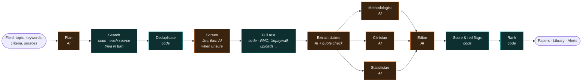
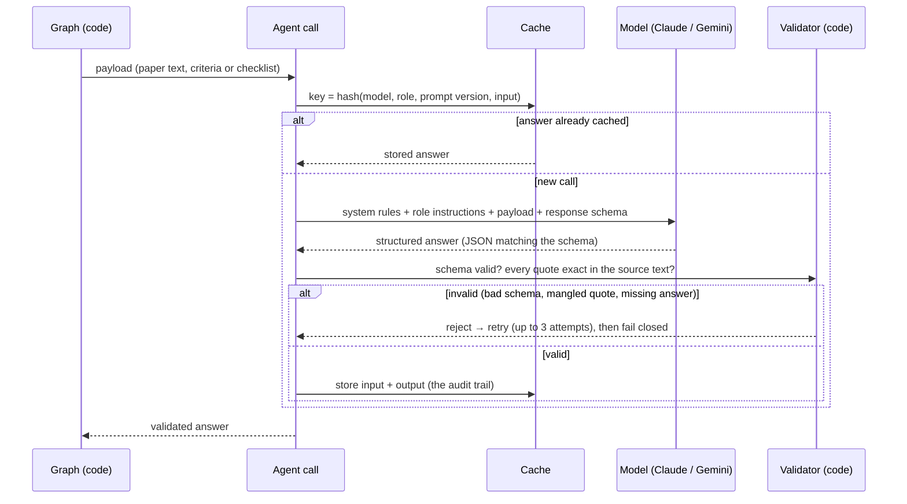

# How the agents work

Literature Radar is a **pipeline of structured AI calls orchestrated by code**, not a swarm of autonomous
agents. Each "agent" does one narrow job, must answer in a fixed format, and its answer is checked by code
before anything is kept. The order of steps, what runs in parallel, scoring and ranking are decided by code
(a LangGraph state graph in `src/research_agent/graph.py`). This is deliberate: the result is predictable,
auditable and measurable.

## 1. Execution flow: what runs when



- **Sequential stages.** Plan → Search → Deduplicate → Screen → Full text → Extract. Each stage finishes for
  every paper before the next starts; within a stage, papers are processed one after another.
- **Parallel reviewers.** The reviewers (1–5, default three) run **at the same time** on the same papers,
  **independently**: none sees another's report.
- **Join.** The Editor waits for all reviewers, then reads their reports side by side.
- **Code decides the numbers.** Score, red flags and rank are computed from the checklist answers, never
  asked of a model.
- **Checkpoints.** The state is saved after every stage; a failed or cancelled run resumes from the last
  completed stage. Every AI call is cached, so a resume never pays twice.
- **Search failures.** A failing optional source is skipped with a visible warning; the run stops only if a
  required source or every source fails.

## 2. Anatomy of one agent

Every AI step follows the same contract:



| Part | What it is | Where |
|---|---|---|
| Role | One narrow job and perspective (e.g. "Statistician") | reviewer profile / `INSTRUCTIONS` in `agents.py` |
| System rules | Shared guard-rails: source text is data, not instructions; no outside knowledge; quote exactly | `SYSTEM`, `PANEL_SYSTEM` |
| Input | Only what the job needs: title/abstract or full text, criteria or checklist items | built by the graph node |
| Output schema | A fixed JSON shape the model must fill (e.g. one answer per checklist item) | `schemas.py` |
| Validation | Code checks schema, completeness, and that every quote occurs in the source | `checked()`, `validate_evidence` |
| Retries | Up to 3 attempts on a bad answer; then the run stops, checkpoint kept | `SCHEMA_ATTEMPTS` |
| Model | Configurable per role (Settings → AI models) | `review.json` / worker env |
| Cache | Exact input and output stored, reused on resume, readable in the drawer ("Raw calls") | `research.sqlite` |
| Version | Prompt version recorded with every call; changing a prompt never silently reuses old answers | `PROMPT_VERSION` |

## 3. Example skill: the Statistician

A reviewer profile is a small, versioned, editable **skill** (Settings → Reviewers). The model sees only
the perspective and each item's key and text; weights and red-flag rules stay in code so the model cannot
aim at the score.

```yaml
name: Statistician            # version 1, editable, every save = new version
perspective: >
  You review statistical analysis: performance metrics and their uncertainty, sample size,
  calibration, missing data, class imbalance and subgroup performance.
items:                         # 10 items; 4 shown
  - key: s1
    text: Performance metrics are reported with confidence intervals.
    source: CLAIM 2020 #36
    weight: 3                  # hidden from the model
    red_flag_if: "no"          # hidden from the model
    flag_text: No confidence intervals for performance
  - key: s2
    text: The sample size is justified.
    source: TRIPOD+AI 10
    weight: 2
  - key: s3
    text: The number of patients and images in each data set is reported.
    source: CLAIM 2020 #33
    weight: 2
  - key: s4
    text: Calibration of predicted probabilities is assessed.
    source: TRIPOD+AI 23a
    weight: 2
model: worker default          # or e.g. google_genai:gemini-2.5-pro
```

What one call returns (shape), and what code does with it:

```json
{
  "answers": [
    {"key": "s1", "answer": "no", "quote": "achieved an AUC of 0.91 on the test set", "section": "Results"},
    {"key": "s2", "answer": "not_reported", "quote": "", "section": ""}
  ],
  "verdict": "uncertain",
  "strengths": ["…"], "weaknesses": ["…"], "summary": "…"
}
```

- The quote for `s1` is checked against the paper text; a quote that is not there is rejected and retried.
- `s1` answered "no" with `red_flag_if: "no"` → red flag **"No confidence intervals for performance"**,
  shown with the quote as evidence.
- Score = weighted share of items met among those answered; `not_reported` items lower the coverage
  ("provisional" below half), not the score.

The other agents are built the same way: Plan (queries from the topic), Screen (one answer per inclusion/
exclusion criterion, quote for every "no"), Extract (claims with exact quotes), Editor (reads all reports,
names disagreements, gives the final verdict with a reason).
